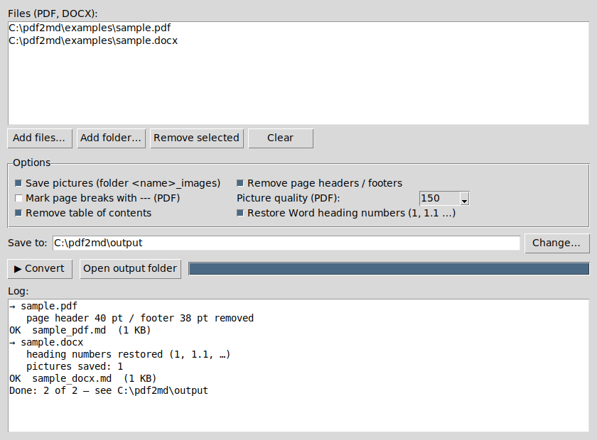

# pdf2md

Convert **PDF** and **Word (.docx)** documents to clean **Markdown** — headings, tables, lists and pictures —
ready for wikis, Git repositories, static sites or as context for AI / RAG tools.

Real documents are full of things you don't want in the text: the same header and footer on every page,
a table of contents, "Page 3 of 15", letters typed in the Symbol font, heading numbers that Word generates
but never stores. pdf2md removes or repairs them for you.



## Features

**PDF**
- Headings, bold/italic, tables and lists via [PyMuPDF4LLM](https://github.com/pymupdf/RAG); pictures saved as PNG.
- **Page headers/footers removed** — text that repeats on at least half of the pages (page numbers and dates may
  differ) is detected and cut off.
- Table of contents and "Page N of M" lines removed; optional `---` page-break markers.
- Scanned PDFs without a text layer and password-protected PDFs are reported clearly.

**Word (.docx)**
- Headers, footers and review comments are skipped; the table of contents is removed.
- **Symbol-font letters fixed** — text typed in the Symbol font (`m` shown as µ, `W` as Ω …) becomes real Unicode.
- **Heading numbers restored** — Word's automatic numbering (1, 1.1, 1.1.1) is not stored in the text; pdf2md
  puts it back.
- Caption numbers (`Figure 3`, `Table 1`) are kept; tables get a proper header row; EMF/WMF pictures are converted
  to PNG on Windows.

**Both**
- A small window and a command line; whole folders at once.
- `Manual.pdf` and `Manual.docx` side by side become `Manual_pdf.md` and `Manual_docx.md` — nothing is overwritten.
- Works offline — the libraries can be installed from a local `wheels` folder.

## Quick start

Needs **Python 3.10+** ([python.org](https://www.python.org/downloads/) — on Windows tick *Add python to PATH*).

**Windows:** download the release zip, unpack (e.g. to `C:\pdf2md`) and double-click **`run_gui.bat`**.
The first start creates a private environment (`venv`) in the folder and installs the libraries.

**Any OS / manual:**

```bash
git clone https://github.com/AlexeyKoz/pdf2md.git
cd pdf2md
python -m venv venv
# Windows: venv\Scripts\activate     Linux/macOS: source venv/bin/activate
pip install -r requirements.txt
python pdf2md_gui.py
```

Try it on `examples/sample.pdf` and `examples/sample.docx` (generated by `examples/make_samples.py`).

## Using the window

1. **Add files…** or **Add folder…** (you can also drop files or folders onto `run_gui.bat`).
2. Check the options — the defaults suit most documents.
3. **▶ Convert**. Each document becomes `<name>.md` plus a `<name>_images` folder in the output folder;
   picture links in the `.md` are relative, so you can move the pair anywhere.

| Option | What it does |
|--------|--------------|
| Save pictures | writes the pictures to `<name>_images` and links them from the Markdown |
| Remove page headers / footers | PDF: cuts repeated header/footer text (Word ones are always skipped) |
| Mark page breaks | PDF: puts `---` and a `<!-- page N -->` comment between pages |
| Picture quality | PDF: resolution of the saved pictures (150 dpi is usually enough) |
| Remove table of contents | drops TOC lines and the "Table of contents" heading |
| Restore Word heading numbers | puts 1, 1.1, 1.1.1 back in front of auto-numbered Word headings |

## Command line

```bash
python pdf2md.py                              # every PDF/DOCX in input/  ->  output/
python pdf2md.py report.pdf C:\docs\specs     # given files and folders
python pdf2md.py C:\docs --out C:\md --dpi 200 --page-sep
```

Options: `--out DIR`, `--no-images`, `--keep-headers`, `--keep-toc`, `--no-numbering`, `--page-sep`, `--dpi N`,
`--version`. On Windows, `run.bat` converts everything in `input\` (or the files you drop onto it).

## Limits

- **Scans** (pages that are pictures) contain no text — run OCR first.
- **Old `.doc`** files are not supported — open them in Word and *Save As → Word Document (.docx)*.
- **Complex layouts** (multi-column pages, text boxes, merged table cells) may need manual touch-ups.
- **EMF/WMF pictures** from Word are converted to PNG only on Windows; elsewhere they stay `.emf`/`.wmf`.
- PyMuPDF4LLM is kept below 1.0 on purpose: from 1.0 on it always installs its new "layout" engine (onnxruntime,
  numpy … — about 200 MB) and runs OCR over pictures, while header/footer removal relies on the classic engine.
  If a 1.x version is installed anyway, pdf2md switches it to the classic engine itself.

## Offline / restricted PCs

See [docs/WINDOWS_OFFLINE.md](docs/WINDOWS_OFFLINE.md) — preparing a `wheels` folder and copy-paste PowerShell/CMD
commands for PCs where `.bat` files are blocked.

## Project files

| File | What it is |
|------|------------|
| `pdf2md_gui.py` | the window (tkinter, part of standard Python) |
| `pdf2md.py` | the converter; also the command-line tool |
| `run_gui.bat`, `run.bat` | Windows launchers (create `venv` on first start) |
| `examples/` | `sample.pdf`, `sample.docx` and `make_samples.py` that generates them |

## License

[MIT](LICENSE) © 2026 Alexey Kozlov
